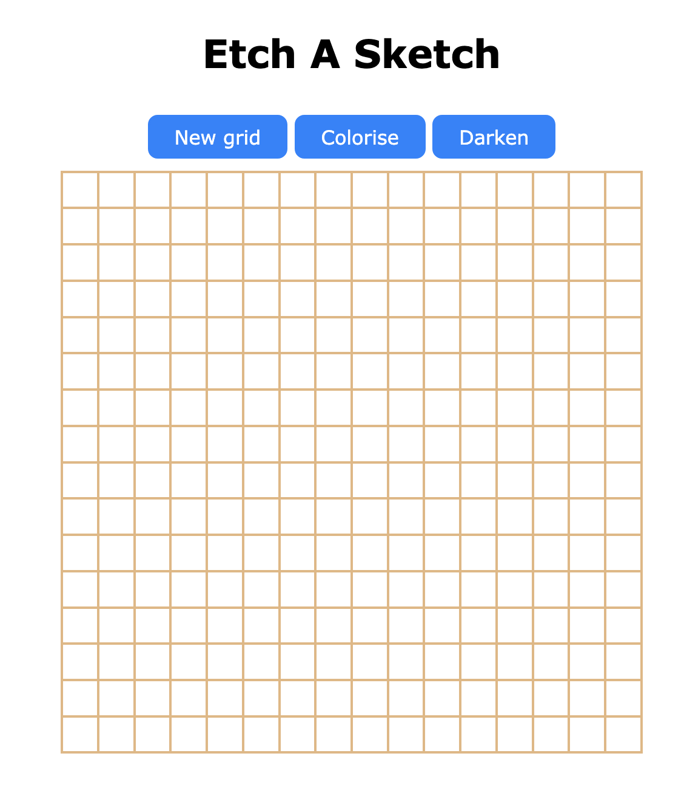

# Etch A Sketch

A version of something between a sketchpad and an Etch-A-Sketch, written in JavaScript.

🔗 **[Online demo](https://ikab08.github.io/rock-paper-scissor/)**

## Features
- Default 16x16 grid, customizable from 1 to 100 squares per side
- "New grid" button to start over with a new size
- Draw by hovering over the grid squares with your mouse
- "Darken" mode: each pass darkens the square by 10%, up to full black
- "Colorise" mode: each square gets a random color 

## Technologies
HTML, CSS, JavaScript

## Run locally
Clone the repository, then open `index.html` in your browser.